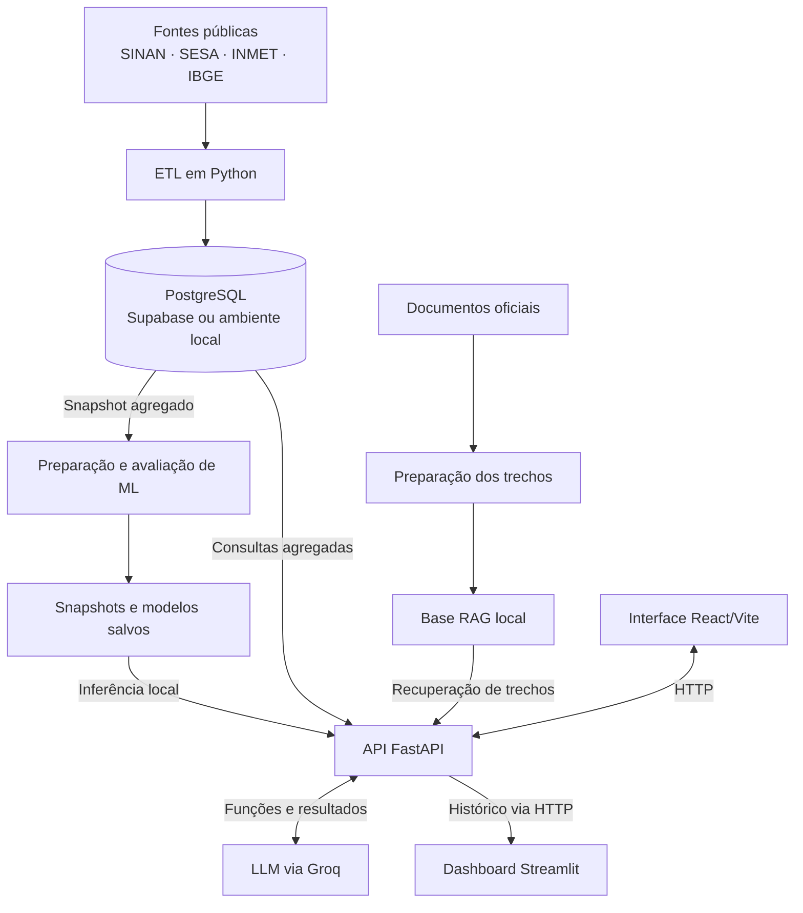

# DenguePrev — Espírito Santo

Plataforma acadêmica para explorar registros públicos de dengue nos **78
municípios do Espírito Santo**, consultar dados climáticos e populacionais e
acompanhar estimativas de curto prazo com explicações apoiadas por IA.

Desenvolvido no **Projeto Integrador IV**, o DenguePrev reúne tratamento de
dados, banco relacional, análise preditiva e consulta em linguagem natural.
As análises preservam a origem dos dados, a referência temporal e as limitações
de interpretação.

## O que a aplicação oferece
## Acesso online

- **Aplicação Web (Frontend):** https://pi-iv-dengue-prev.vercel.app
- **API e Documentação interativa (Backend):** https://dengueprev-api.onrender.com/docs

> **Nota:** A API está hospedada no plano gratuito do Render e entra em hibernação após 15 minutos sem uso. No primeiro acesso, o carregamento inicial pode levar cerca de 40 a 50 segundos enquanto o servidor é reativado.
- **Histórico municipal:** consulta por município, ano e semana epidemiológica.
- **Exploração territorial:** mapa dos 78 municípios e comparação entre duas
  cidades nas semanas com observações em comum.
- **Indicadores e contexto:** registros por 100 mil habitantes, população,
  clima e disponibilidade das observações.
- **Estimativas de curto prazo:** resultados de experimentos temporais, com
  estratégia, métricas, versão e motivos de indisponibilidade.
- **Assistente em linguagem natural:** consulta dados e compara municípios
  por funções controladas do backend.
- **Respostas documentais:** recupera trechos oficiais sobre dengue e apresenta
  referências com origem e página.

Esses recursos são disponibilizados pela API e pela interface React/Vite em
`frontend/`, com Histórico, Comparar, Previsões e Assistente. O histórico reúne
gráfico, mapa, população e clima; os filtros podem ser compartilhados pelo link
da consulta. Cada página oferece instruções de uso. O dashboard Streamlit
permanece disponível como visualização provisória do histórico SINAN.

## Arquitetura



O processamento e o treinamento preparam os recursos que a aplicação utiliza.
Durante o uso, a API consulta o banco, executa a inferência com o experimento
salvo e coordena o assistente. Essa separação permite evoluir a interface,
os modelos e as fontes de dados em seus respectivos componentes.

| Componente | Tecnologias e local | Papel e importância |
| --- | --- | --- |
| Preparação dos dados | Python, Pandas e NumPy · `pipelines/` | Transforma arquivos heterogêneos em agregados semanais, conferindo datas, códigos, origem e integridade. |
| Persistência e integração | PostgreSQL, Supabase e SQLAlchemy · `backend/models.py`, `povoar_banco.py` e `analitica.py` | Mantém chaves e restrições, sincroniza as fontes e oferece visões analíticas que preservam contagens e lacunas. |
| API | FastAPI e Pydantic · `backend/main.py` e `schemas.py` | Fornece contratos de consulta e validação para as interfaces e integrações. |
| Machine Learning | scikit-learn e Joblib · `ml/` e `backend/previsoes.py` | Compara estratégias com cortes temporais e disponibiliza estimativas reproduzíveis com métricas e elegibilidade. |
| Assistente | Groq, HTTPX e function calling · `backend/assistente.py` e `ferramentas_ia.py` | Interpreta perguntas e explica resultados obtidos por operações de leitura previamente definidas. |
| Recuperação documental | TF-IDF, scikit-learn e pypdf · `backend/rag.py` e `pipelines/preparar_rag.py` | Fundamenta respostas em trechos oficiais rastreáveis e fornece os dados para citações verificáveis. |
| Visualização | React, TypeScript e Vite · `frontend/`; Streamlit provisório em `app.py` | Organiza navegação, filtros, histórico, estimativas e assistente. Node.js executa as ferramentas do frontend. |
| Qualidade | Pytest, SQLite e provedores simulados · `tests/` | Verifica regras de processamento, integridade, contratos da API e controles da integração com IA. |

A descrição de cada arquivo e suas funções está no
[guia dos fontes](docs/guia-codigo.md).

## Como funciona

1. **Preparar:** os pipelines leem os arquivos originais, validam seu conteúdo e geram agregados e resumos com identificação de origem.
2. **Organizar:** o carregador sincroniza os dados no PostgreSQL, por meio de visões que integram município, calendário, registros, população e clima.
3. **Avaliar:** o módulo de ML fixa a fonte selecionada, cria variáveis históricas, compara estratégias e registra o experimento com sua avaliação.
4. **Consultar:** a API disponibiliza histórico, indicadores e estimativas respeitando filtros, datas, fontes e regras de disponibilidade.
5. **Explicar:** o assistente aciona funções do backend ou consulta documentos oficiais; a LLM sintetiza os resultados e o backend valida a resposta e suas referências.

Consultas sobre dados e números municipais usam as ferramentas de dados, enquanto perguntas conceituais ou preventivas recorrem à base documental. Todos os cálculos de estimativas e comparações permanecem no backend.

## Fontes de dados 

| Fonte | Informação utilizada | Contribuição |
| --- | --- | --- |
| SINAN | Registros por residência e semana dos primeiros sintomas. | Histórico municipal e experimento preditivo próprio, incluindo a extração parcial de 2026. |
| SESA/e-SUS VS | Registros estaduais por semana de notificação, de 2020–2024. | Série e experimento separados para análise temporal. |
| INMET | Observações e metadados de estações meteorológicas. | Chuva, temperatura, umidade e cobertura de observações semanais. |
| IBGE | Cadastro municipal, população e centroides. | Identificação dos municípios, denominadores dos indicadores e vínculos geográficos com estações. |
| Ministério da Saúde | Documentos oficiais selecionados sobre dengue e vigilância. | Fundamentação das respostas documentais do assistente. |

SINAN e SESA mantêm referências temporais e extrações próprias. Suas contagens
permanecem separadas. O indicador populacional descreve registros da extração
por 100 mil habitantes; sua interpretação depende dos critérios e da cobertura
de cada fonte.

Os [catálogos do pacote original](docs/inventario-bases.json) e das
[fontes adicionais de 2026](docs/fontes-2026.json) identificam os arquivos
utilizados. A [base documental](docs/base-documental.json) registra textos,
edições, páginas e hashes dos documentos do RAG.

## Interpretação dos resultados

- **Ausência e zero têm significados distintos:** semanas sem registros observados permanecem marcadas como ausentes tanto nas consultas quanto nos critérios de elegibilidade do ML.
- **As estimativas refletem o snapshot ativo:** cada resposta informa a data de referência dos dados e o horizonte estimado. Nos experimentos vigentes, o modelo de persistência (que repete a última contagem observada) foi selecionado por não haver ganho comprovado sobre essa linha de base.
- **O clima possui limites de representação espacial:** a associação entre municípios e estações baseia-se em proximidade geográfica e disponibilidade de leitura dos sensores, com adequação meteorológica ainda em avaliação.
- **As respostas da IA exigem rastreabilidade:** o fluxo é controlado por funções autorizadas, validação de parâmetros e citação de fontes, sendo complementado por testes semânticos e conferência dos resultados.

O detalhamento técnico dessas avaliações e suas respectivas limitações estão documentados em
[ML SESA](docs/avaliacao-ml.md),
[SINAN 2026](docs/avaliacao-sinan-2026.md) e
[assistente e RAG](docs/avaliacao-assistente.md).

## Executar localmente

Use Python 3.10 ou superior. Para preparar um ambiente novo, execute na raiz:

```powershell
python -m venv .venv
.venv\Scripts\python.exe -m pip install -r requirements.txt
```

Configure seu `.env` local seguindo o [.env.example](.env.example).
As consultas ao banco exigem acesso ao PostgreSQL preparado; as previsões
também dependem dos snapshots e modelos locais correspondentes. O assistente
real utiliza a configuração Groq do backend.

Inicie a API:

```powershell
.venv\Scripts\python.exe -B -m uvicorn backend.main:app --reload
```

Em outro terminal, use Node.js 24.16 ou uma versão compatível com
`frontend/package.json` para instalar e iniciar a interface:

```powershell
npm.cmd --prefix frontend ci
npm.cmd --prefix frontend run dev
```

- [Documentação interativa da API](http://127.0.0.1:8000/docs).
- [Interface local](http://127.0.0.1:5173).

Execute cada linha separadamente, mantendo o terminal na raiz do projeto.
No PowerShell, `npm.cmd` também evita o bloqueio do script `npm.ps1`.

O [guia de execução](docs/execucao.md) detalha a obtenção das fontes, o ETL,
a carga, a preparação dos modelos e os exemplos de consulta.

### Dados e configuração

O Git contém o código, os testes, a documentação e a base documental pequena.
Os dados originais são distribuídos separadamente pela
[Release de dados](https://github.com/J-Emanoel/pi-iv-dengue-prev/releases/tag/dados-originais-v1)
e pelas fontes identificadas nos catálogos.

Credenciais, ambiente virtual, dados processados e artefatos de ML ficam fora
dos commits. Quem prepara outro ambiente deve obter os dados necessários e
reproduzir os experimentos ou disponibilizar os artefatos compatíveis conforme
o [guia de execução](docs/execucao.md).

### Testes

```powershell
.venv\Scripts\python.exe -B -m pytest -q -p no:cacheprovider
npm.cmd --prefix frontend test
npm.cmd --prefix frontend run build
```

## Documentação do projeto

| Documento | Conteúdo |
| --- | --- |
| [Guia dos fontes](docs/guia-codigo.md) | Função de cada arquivo, importância dos componentes e ordem de leitura do código. |
| [Guia de execução](docs/execucao.md) | Instalação, preparação dos dados, carga, treinamento e uso dos serviços. |
| [Contexto e planejamento](docs/contexto-projeto.md) | Decisões de implementação, sequência de desenvolvimento e checklist. |
| [Análise das bases](docs/analise-bases.md) | Diagnóstico das fontes e critérios adotados no processamento. |
| [Avaliação de ML](docs/avaliacao-ml.md) | Protocolo e resultados do experimento SESA. |
| [Avaliação SINAN 2026](docs/avaliacao-sinan-2026.md) | Compatibilidade da atualização e avaliação do experimento SINAN. |
| [Avaliação do assistente e RAG](docs/avaliacao-assistente.md) | Testes, consumo informado, resultados e limitações da integração com IA. |
